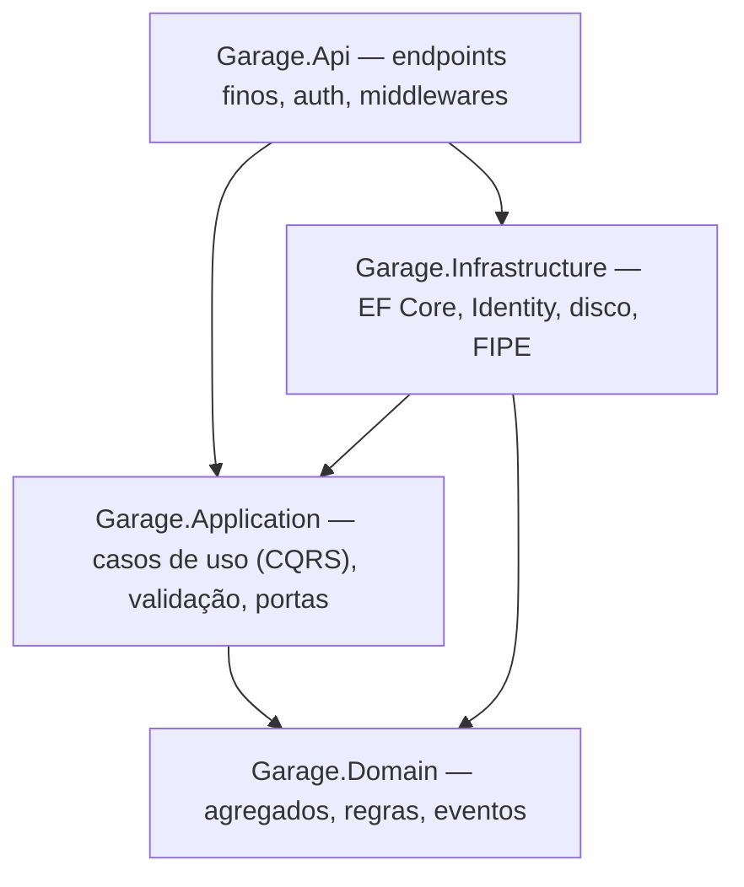

# Garagem — histórico de manutenção e modificações de veículos

Aplicação web para manter o histórico completo de um carro: manutenções e modificações com peças e custos, fotos e notas fiscais, lembretes de manutenção preventiva por km ou tempo e um link público, só de leitura, para mostrar o histórico a um comprador, mecânico ou amigo.

Nasceu de uma necessidade real: documentar o meu Honda Civic EK 1998, em restauração, e para estudar arquitetura de software em .NET.

- **No ar:** https://garagem.frauchesgabriel.work (uso pessoal; o cadastro de novas contas está fechado)
- **Como funciona por dentro:** [`docs/ARQUITETURA.md`](docs/ARQUITETURA.md)
- **Rodar localmente:** [`backend/README.md`](backend/README.md)

## O que o app faz

- **Veículos** escolhidos pelo catálogo da **FIPE** (marca → modelo → ano), com preenchimento manual quando a FIPE está fora do ar.
- **Registros** de manutenção e de modificação com peças, quantidades, preços, mão de obra e "peça original substituída".
- **Regras de km** que mantêm o histórico coerente: a km não volta, e cada registro precisa caber entre o anterior e o seguinte.
- **Anexos**: fotos tiradas na hora pelo celular e PDFs. Tipo detectado pelos bytes, EXIF/GPS removidos, imagens convertidas para sRGB e redimensionadas.
- **Lembretes** por km, por tempo ou "o que vier primeiro", com painel de vencidos e próximos.
- **Link público** só de leitura, por lista de campos permitidos: custos e placa só quando o dono permite. Chassi, documentos, observações e lembretes nunca aparecem.

## Stack

| Camada | Tecnologias |
|---|---|
| Back-end | .NET 10, ASP.NET Core Minimal APIs, EF Core + PostgreSQL, ASP.NET Identity (cookie + antiforgery), FluentValidation, Serilog, Magick.NET, OpenAPI + Scalar |
| Front-end | React 19, TypeScript, Vite, Tailwind CSS v4, TanStack Query, React Hook Form + Zod, tipos gerados do OpenAPI |
| Testes | xUnit, Testcontainers (Postgres real), NetArchTest, Vitest + Testing Library |
| Infra | Docker (imagem única: a API serve o front), Coolify numa VPS, Traefik com HTTPS, Cloudflare DNS |

## Arquitetura em 30 segundos

- **Clean Architecture + DDD tático + CQRS**, com um despachante próprio (sem MediatR) e decorators de log, validação e transação.
- **`Result`/`Error` em vez de exceções**, convertidos em ProblemDetails (RFC 9457) com código estável.
- **Eventos de domínio** despachados na mesma transação: lançar um registro cumpre os lembretes escolhidos atomicamente.
- **Concorrência otimista** com o `xmin` do Postgres.
- **FIPE como camada anticorrupção**, com cache em banco, resiliência e fallback.
- **Fronteiras entre camadas garantidas por testes de arquitetura.**

Os detalhes, com diagramas do caminho de uma requisição e do domínio, estão em [`docs/ARQUITETURA.md`](docs/ARQUITETURA.md).

## Testes

756 testes automatizados: 525 no back-end e 231 no front-end.

- **Domínio:** regras de km, cronologia, status de lembrete, assinatura de arquivo.
- **Integração:** com Postgres real em container, cobre autenticação, CSRF, rate limit e cada endpoint.
- **Vazamentos na página pública:** o JSON é comparado contra uma lista de campos proibidos.
- **Contrato OpenAPI:** garante o contrato que gera os tipos do front.

## Como este projeto foi construído

O projeto foi feito com **agentes de IA (Claude)** num fluxo orientado por especificação, em poucos dias (10 a 12/10/2026). Os commits trazem `Co-Authored-By` de propósito: é o registro honesto de como o código foi produzido.

**O que foi meu:**
- O produto e as regras de negócio, tiradas do uso real no meu carro: o que conta como km válida, o que pode aparecer num link público, como os lembretes vencem.
- As escolhas de arquitetura e de stack, com o trade-off de cada uma registrado na spec: Clean Architecture + DDD + CQRS, Minimal APIs, FIPE desde o MVP, Coolify na VPS.
- A revisão e as decisões em cada etapa, inclusive o que foi aceito ou mudado nas revisões.

**Como o trabalho foi conduzido:**
1. **Spec de design** com regras de domínio numeradas, endpoints, erros, segurança e testes: [`docs/superpowers/specs/`](docs/superpowers/specs/).
2. **Planos de implementação** quebrados em tarefas pequenas, com interfaces e testes definidos antes do código: [`docs/superpowers/plans/`](docs/superpowers/plans/).
3. **Implementação por tarefa com TDD:** teste falhando primeiro, depois o código.
4. **Revisão independente** de cada tarefa sensível (autenticação, anexos, link público, deploy) e uma **revisão final** do código inteiro, seguida de uma rodada de correções e de uma nova revisão.

## Roadmap

| Fase | Conteúdo |
|---|---|
| **1 — MVP** (concluída) | Login, veículos com FIPE, registros com peças, anexos, lembretes, link público |
| 2 — Planejar e colaborar | Roadmap de modificações com orçamento, linha do tempo antes/depois, dossiê em PDF, colaboradores (coproprietário, mecânico) |
| 3 — Dados e comunidade | Planos de revisão por modelo, perfil público do build, relatórios de custo, abastecimento, IA lendo nota fiscal |
