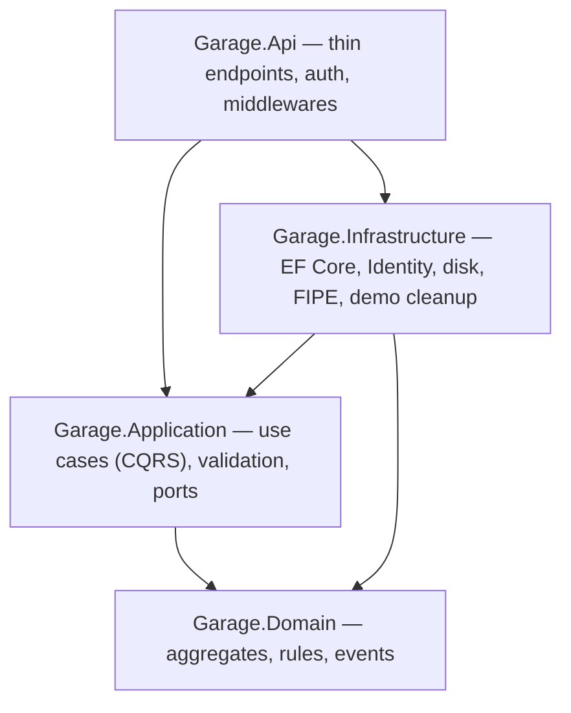

# Garagem — maintenance and modification history for your car

**[Português](README.pt-BR.md)**

A web app that keeps the complete history of a car: maintenance and modifications with parts and costs, photos and invoices, preventive reminders by mileage or time, spending per category and per month, and a read-only public link to show the history to a buyer, a mechanic or a friend.

It started from a real need — documenting my 1998 Honda Civic EK, under restoration — and became a study in .NET software architecture.

- **Live:** https://garagem.frauchesgabriel.work — click **"Ver demo"**: no sign-up, you get your own copy of two example cars, deleted after 24 hours.
- **How it works inside:** [`docs/ARQUITETURA.md`](docs/ARQUITETURA.md) (Portuguese)
- **Run it locally:** [`backend/README.md`](backend/README.md) (Portuguese)

## What it does

- **Vehicles** picked from Brazil's **FIPE** catalog (make → model → year), with manual entry when FIPE is down, and a **cover photo** chosen among the photos already attached to the car.
- **Records** of maintenance and modifications with parts, quantities, prices, labor and the "original part replaced".
- **Mileage rules** that keep the history consistent: mileage never goes back, and each record must fit between the previous and the next one.
- **Attachments**: photos taken on the phone and PDFs. Type detected from the bytes, EXIF/GPS stripped, images converted to sRGB and resized.
- **Reminders** by mileage, by time, or "whichever comes first", grouped as overdue, due soon and up to date.
- **Spending**: total, maintenance vs. modification, per category, per month and cost per km (only after 1,000 km tracked, so the number is not misleading).
- **Public link** for buyers, built from an allowlist: costs and plate only when the owner allows it; VIN, documents, invoices, notes and reminders never show up.
- **Visitor demo**: one click creates an isolated, password-less account with the example data (a Civic EK with a full history and a Gol). It cannot upload files, is limited to 5 vehicles, and a background job deletes it, with its files, after 24 hours. Example photos come from Wikimedia Commons under free licenses ([credits](backend/src/Garage.Infrastructure/Demo/Assets/CREDITS.md)).

| Dashboard | Vehicle |
|---|---|
|  |  |

| Spending tab | Public link (buyer's view) |
|---|---|
|  |  |

## Stack

| Layer | Technologies |
|---|---|
| Back end | .NET 10, ASP.NET Core Minimal APIs, EF Core + PostgreSQL, ASP.NET Identity (cookie + antiforgery), FluentValidation, Serilog, Magick.NET, OpenAPI + Scalar |
| Front end | React 19, TypeScript, Vite, Tailwind CSS v4, TanStack Query, React Hook Form + Zod, types generated from OpenAPI |
| Tests | xUnit, Testcontainers (real Postgres), NetArchTest, Vitest + Testing Library |
| Infra | Docker (single image: the API serves the front end), Coolify on a VPS, Traefik with HTTPS, Cloudflare DNS |

## Architecture in 30 seconds

- **Clean Architecture + tactical DDD + CQRS**, with a hand-written dispatcher (no MediatR) and logging, validation and transaction decorators.
- **`Result`/`Error` instead of exceptions**, mapped to ProblemDetails (RFC 9457) with stable error codes.
- **Domain events** dispatched in the same transaction: adding a record fulfills the chosen reminders atomically.
- **Optimistic concurrency** with Postgres `xmin`.
- **FIPE as an anti-corruption layer**, with a database cache, resilience and fallback.
- **Layer boundaries enforced by architecture tests.**

Details, with diagrams of the request path and the domain, are in [`docs/ARQUITETURA.md`](docs/ARQUITETURA.md).

## Tests

872 automated tests: 592 on the back end and 280 on the front end.

- **Domain:** mileage rules, chronology, reminder status, file signatures, the cover-photo rule.
- **Integration:** against a real Postgres in a container — authentication, CSRF, rate limiting, every endpoint, spending summaries, the visitor demo (session, restrictions, cleanup).
- **Public-link leaks:** the JSON is checked against a list of forbidden fields.
- **OpenAPI contract:** protects the contract the front-end types are generated from.

## How this project was built

The project was built with **AI agents (Claude)** in a spec-driven workflow: the MVP in a few days (Oct 10–12, 2026) and the new interface with the visitor demo on Oct 16, 2026. Commits carry `Co-Authored-By` on purpose: it is the honest record of how the code was produced.

**What was mine:**
- The product and the business rules, taken from real use on my car: what counts as valid mileage, what may appear on a public link, how reminders come due, what the demo may and may not do.
- The architecture and stack choices, with the trade-off of each one recorded in the specs: Clean Architecture + DDD + CQRS, Minimal APIs, FIPE from the MVP, Coolify on a VPS, one demo account per visitor instead of a shared one.
- The review and the decisions at every step, including what was accepted or changed in reviews.

**How the work was run:**
1. **Design spec** with numbered domain rules, endpoints, errors, security and tests: [`docs/superpowers/specs/`](docs/superpowers/specs/).
2. **Implementation plans** broken into small tasks, with interfaces and tests defined before the code: [`docs/superpowers/plans/`](docs/superpowers/plans/).
3. **Task-by-task implementation with TDD:** a failing test first, then the code.
4. **Review:** independent review of sensitive tasks (authentication, attachments, public link, deploy) and a **final review** of the whole branch, followed by a round of fixes.

**The new interface (Oct 16):** HTML mockups approved first (landing, dashboard, vehicle page, public link, visual direction "Ficha técnica"), then a spec and a 19-task plan: the back end for the cover photo, spending summaries and the visitor demo, then the front end screen by screen, with each screen checked in screenshots at desktop and phone widths.

## Roadmap

| Phase | Content |
|---|---|
| **1 — MVP** (done) | Login, vehicles with FIPE, records with parts, attachments, reminders, public link |
| **New interface** (done) | Landing with visitor demo, dashboard with spending, cover photos, buyer-oriented public link |
| 2 — Plan and collaborate | Modification roadmap with budget, before/after timeline, PDF dossier, collaborators (co-owner, mechanic) |
| 3 — Data and community | Service plans per model, public build profile, cost reports, fuel log, AI reading invoices |
