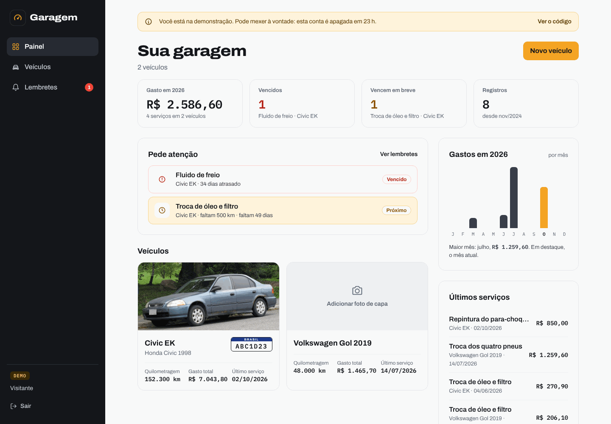
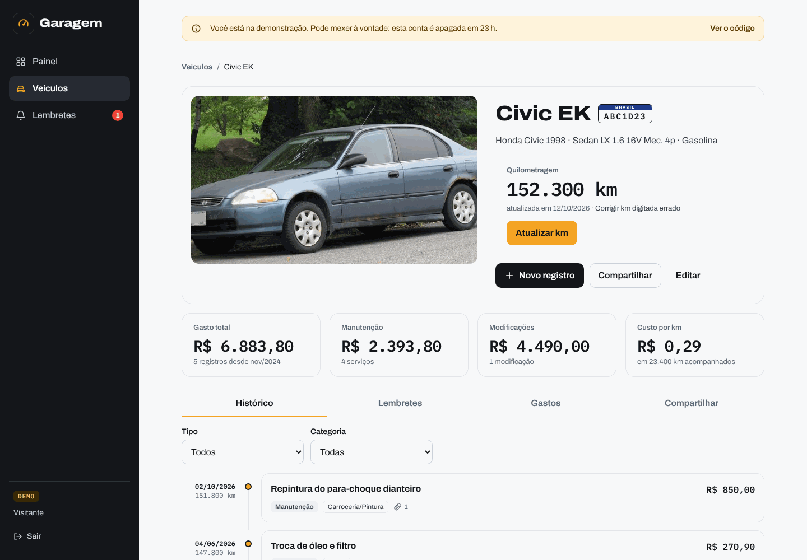
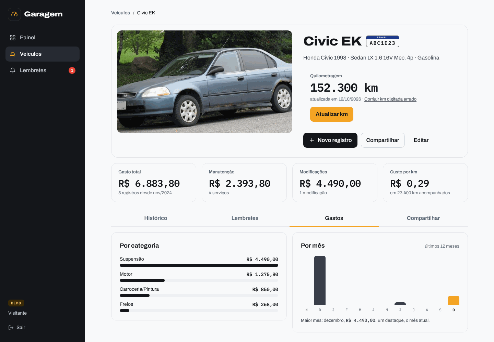
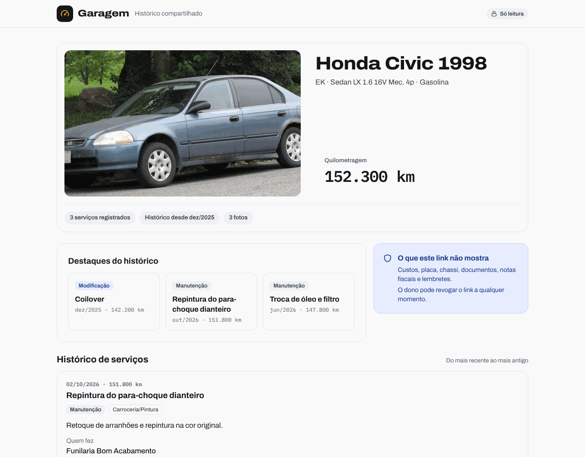
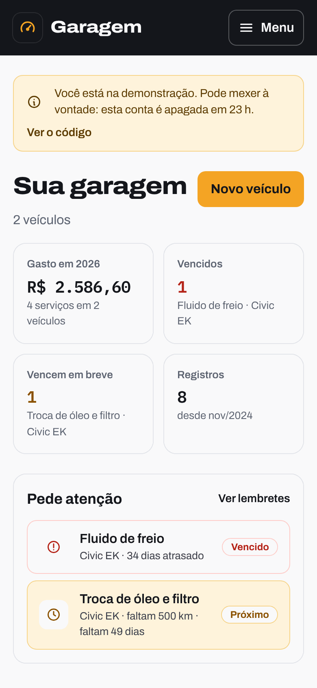
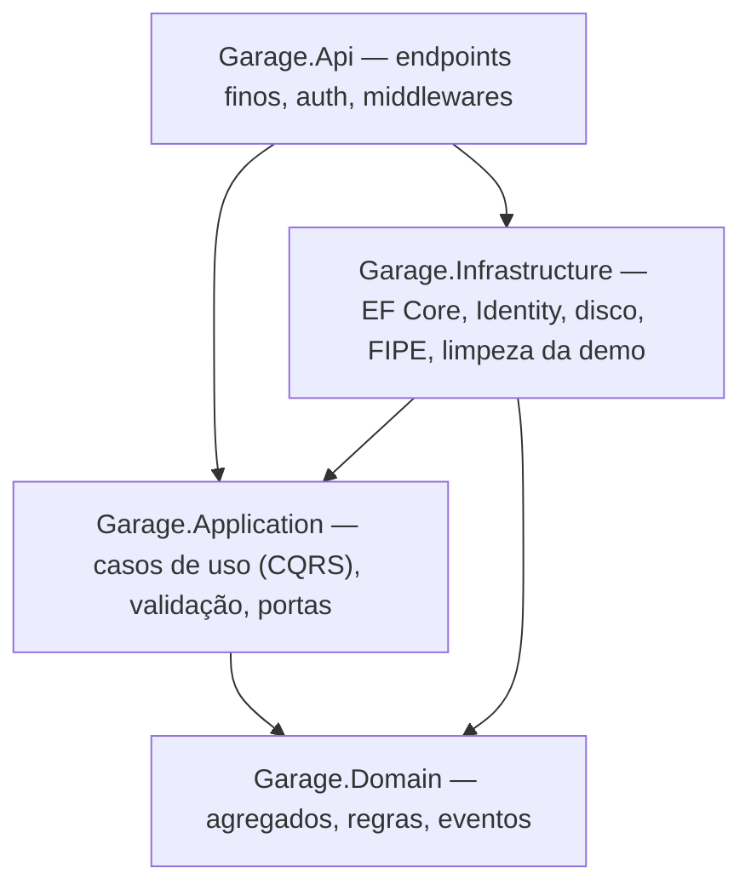

# Garagem — histórico de manutenção e modificações de veículos

**[English](README.md)**

Aplicação web para manter o histórico completo de um carro: manutenções e modificações com peças e custos, fotos e notas fiscais, lembretes de manutenção preventiva por km ou tempo, gastos por categoria e por mês e um link público, só de leitura, para mostrar o histórico a um comprador, mecânico ou amigo.

Nasceu de uma necessidade real: documentar o meu Honda Civic EK 1998, em restauração, e para estudar arquitetura de software em .NET.

- **No ar:** https://garagem.frauchesgabriel.work — clique em **"Ver demo"**: sem cadastro, você ganha uma cópia sua de dois carros de exemplo, apagada em 24 horas.
- **Como funciona por dentro:** [`docs/ARQUITETURA.md`](docs/ARQUITETURA.md)
- **Rodar localmente:** [`backend/README.md`](backend/README.md)

## O que o app faz

- **Veículos** escolhidos pelo catálogo da **FIPE** (marca → modelo → ano), com preenchimento manual quando a FIPE está fora do ar, e **foto de capa** escolhida entre as fotos já anexadas ao carro.
- **Registros** de manutenção e de modificação com peças, quantidades, preços, mão de obra e "peça original substituída".
- **Regras de km** que mantêm o histórico coerente: a km não volta, e cada registro precisa caber entre o anterior e o seguinte.
- **Anexos**: fotos tiradas na hora pelo celular e PDFs. Tipo detectado pelos bytes, EXIF/GPS removidos, imagens convertidas para sRGB e redimensionadas.
- **Lembretes** por km, por tempo ou "o que vier primeiro", agrupados em vencidos, próximos e em dia.
- **Gastos**: total, manutenção x modificação, por categoria, por mês e custo por km (só a partir de 1.000 km acompanhados, para o número não enganar).
- **Link público** para o comprador, montado por lista de campos permitidos: custos e placa só quando o dono permite. Chassi, documentos, notas fiscais, observações e lembretes nunca aparecem.
- **Demo por visitante**: um clique cria uma conta isolada, sem senha, com os dados de exemplo (um Civic EK com histórico completo e um Gol). Ela não envia arquivos, tem no máximo 5 veículos e um serviço em segundo plano a apaga, com os arquivos, depois de 24 horas. As fotos de exemplo vêm do Wikimedia Commons, com licenças livres ([créditos](backend/src/Garage.Infrastructure/Demo/Assets/CREDITS.md)).

| Painel | Veículo |
|---|---|
|  |  |

| Aba Gastos | Link público (o que o comprador vê) |
|---|---|
|  |  |

## Stack

| Camada | Tecnologias |
|---|---|
| Back-end | .NET 10, ASP.NET Core Minimal APIs, EF Core + PostgreSQL, ASP.NET Identity (cookie + antiforgery), FluentValidation, Serilog, Magick.NET, OpenAPI + Scalar |
| Front-end | React 19, TypeScript, Vite, Tailwind CSS v4, TanStack Query, React Hook Form + Zod, tipos gerados do OpenAPI |
| Testes | xUnit, Testcontainers (Postgres real), NetArchTest, Vitest + Testing Library |
| Infra | Docker (imagem única: a API serve o front), Coolify numa VPS, Traefik com HTTPS, Cloudflare DNS |

## Arquitetura em 30 segundos

- **Clean Architecture + DDD tático + CQRS**, com um despachante próprio (sem MediatR) e decorators de log, validação e transação.
- **`Result`/`Error` em vez de exceções**, convertidos em ProblemDetails (RFC 9457) com código estável.
- **Eventos de domínio** despachados na mesma transação: lançar um registro cumpre os lembretes escolhidos atomicamente.
- **Concorrência otimista** com o `xmin` do Postgres.
- **FIPE como camada anticorrupção**, com cache em banco, resiliência e fallback.
- **Fronteiras entre camadas garantidas por testes de arquitetura.**

Os detalhes, com diagramas do caminho de uma requisição e do domínio, estão em [`docs/ARQUITETURA.md`](docs/ARQUITETURA.md).

## Testes

872 testes automatizados: 592 no back-end e 280 no front-end.

- **Domínio:** regras de km, cronologia, status de lembrete, assinatura de arquivo, regra da capa.
- **Integração:** com Postgres real em container, cobre autenticação, CSRF, rate limit, cada endpoint, os resumos de gastos e a demo por visitante (sessão, restrições e limpeza).
- **Vazamentos na página pública:** o JSON é comparado contra uma lista de campos proibidos.
- **Contrato OpenAPI:** garante o contrato que gera os tipos do front.

## Como este projeto foi construído

O projeto foi feito com **agentes de IA (Claude)** num fluxo orientado por especificação: o MVP em poucos dias (10 a 12/10/2026) e a nova interface com a demo por visitante em 16/10/2026. Os commits trazem `Co-Authored-By` de propósito: é o registro honesto de como o código foi produzido.

**O que foi meu:**
- O produto e as regras de negócio, tiradas do uso real no meu carro: o que conta como km válida, o que pode aparecer num link público, como os lembretes vencem, o que a demo pode ou não fazer.
- As escolhas de arquitetura e de stack, com o trade-off de cada uma registrado nas specs: Clean Architecture + DDD + CQRS, Minimal APIs, FIPE desde o MVP, Coolify na VPS, uma conta demo por visitante em vez de uma conta compartilhada.
- A revisão e as decisões em cada etapa, inclusive o que foi aceito ou mudado nas revisões.

**Como o trabalho foi conduzido:**
1. **Spec de design** com regras de domínio numeradas, endpoints, erros, segurança e testes: [`docs/superpowers/specs/`](docs/superpowers/specs/).
2. **Planos de implementação** quebrados em tarefas pequenas, com interfaces e testes definidos antes do código: [`docs/superpowers/plans/`](docs/superpowers/plans/).
3. **Implementação por tarefa com TDD:** teste falhando primeiro, depois o código.
4. **Revisão:** revisão independente das tarefas sensíveis (autenticação, anexos, link público, deploy) e uma **revisão final** da branch inteira, seguida de uma rodada de correções.

**A nova interface (16/10):** primeiro os mockups em HTML aprovados (landing, painel, página do veículo, link público e a direção visual "Ficha técnica"), depois uma spec e um plano de 19 tarefas: o back-end da capa, dos resumos de gastos e da demo por visitante e, em seguida, o front tela por tela, cada uma conferida em prints no computador e no celular.

## Roadmap

| Fase | Conteúdo |
|---|---|
| **1 — MVP** (concluída) | Login, veículos com FIPE, registros com peças, anexos, lembretes, link público |
| **Nova interface** (concluída) | Landing com demo por visitante, painel com gastos, fotos de capa, link público pensado para o comprador |
| 2 — Planejar e colaborar | Roadmap de modificações com orçamento, linha do tempo antes/depois, dossiê em PDF, colaboradores (coproprietário, mecânico) |
| 3 — Dados e comunidade | Planos de revisão por modelo, perfil público do build, relatórios de custo, abastecimento, IA lendo nota fiscal |
