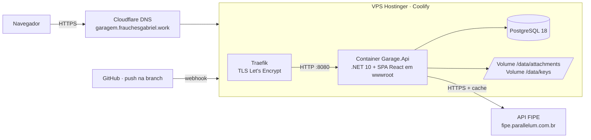
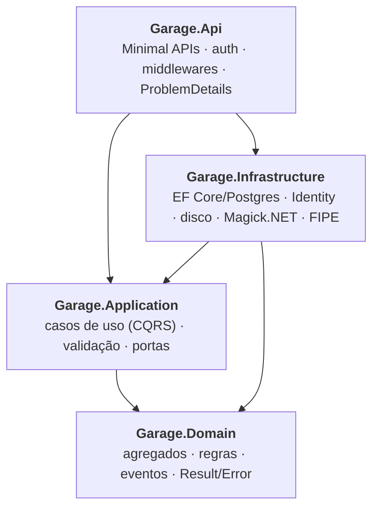
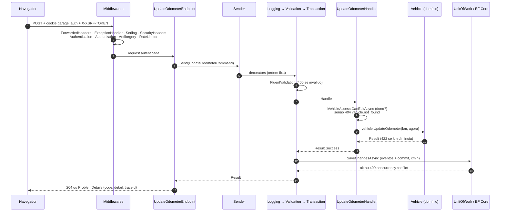
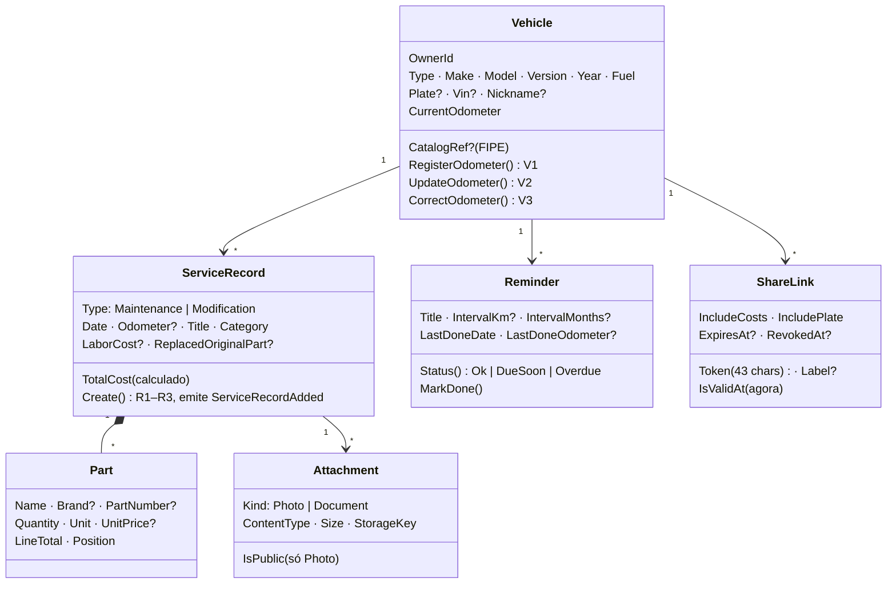
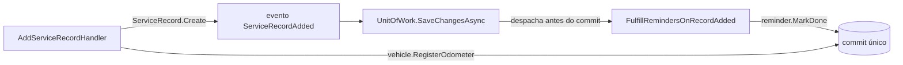

# Garagem — como o app funciona por dentro

> Visão técnica do **appMaintenceHistory** (nome no código: `Garage`), escrita a partir do código da branch `feat/fase1-backend` em 12/10/2026.
> Regras de negócio completas: `docs/superpowers/specs/2026-10-10-fase1-historico-manutencao-design.md`. Plano de execução: `docs/superpowers/plans/`.

## 1. Em uma frase

Uma API .NET 10 que guarda o histórico de manutenções e modificações de cada veículo do usuário, com peças, custos, anexos (fotos e notas fiscais), lembretes por km ou tempo e um link público somente leitura para compartilhar o histórico. O front React (em construção) é servido pela própria API, no mesmo domínio.

## 2. Visão de implantação

- **Deploy:** cada push na branch dispara o build do `backend/Dockerfile` no Coolify. A imagem final roda `docker-entrypoint.sh`, que aplica as migrations (`efbundle`) e sobe a API.
- **Proxy:** o Traefik termina o TLS. A API confia nos cabeçalhos `X-Forwarded-*` dele (esquema para cookie `Secure`, IP real para rate limit).
- **Comando administrativo:** `docker exec … /app/docker-entrypoint.sh reset-password <email>` troca a senha sem subir o servidor.
- **Dados persistentes:** banco no Postgres do Coolify (com backup agendado); arquivos e chaves de Data Protection em volumes (configuração entra no deploy do front).

## 3. Camadas (Clean Architecture)

| Projeto | Responsabilidade | Não pode depender de |
|---|---|---|
| `Garage.Domain` | Entidades e regras puras (km, registros, lembretes, anexos, links). Sem EF, sem ASP.NET. | nada |
| `Garage.Application` | Um caso de uso por pasta (`CreateVehicle/`, `AddServiceRecord/`…): comando ou consulta + handler + validador. Define as **portas** (`IVehicleRepository`, `IFileStorage`, `IVehicleCatalog`, `IAppClock`…). | Infrastructure, Api |
| `Garage.Infrastructure` | Implementa as portas: `GarageDbContext`, repositórios, `UnitOfWork`, `LocalDiskFileStorage`, `MagickImageProcessor`, `FipeVehicleCatalog`, ASP.NET Identity. | Api |
| `Garage.Api` | Endpoints HTTP finos: recebem a requisição, mandam o comando pelo `ISender`, convertem o `Result` em resposta. | — |

Essas fronteiras são **verificadas por teste** (`Garage.ArchitectureTests`, com NetArchTest): se alguém fizer o domínio referenciar o EF, o build de testes quebra.

## 4. O caminho de uma requisição

Exemplo: `POST /api/vehicles/{id}/odometer` (atualizar a km).

Peças-chave:

- **Pipeline:** `ISender` é um despachante próprio (sem MediatR). Comandos passam por `Logging → Validation → Transaction → handler`; consultas por `Logging → Validation → handler`. Registrado com Scrutor em `Application/DependencyInjection.cs`.
- **Result em vez de exceção:** handlers devolvem `Result<T>` com um `Error(code, mensagem, tipo)`. `ResultHttpExtensions.ToProblem` mapeia o tipo para HTTP: Validation 400, NotFound 404, Conflict 409, PayloadTooLarge 413, UnsupportedMedia 415, DomainRule 422, TooManyRequests 429, Unavailable 503. Toda resposta de erro é RFC 9457 com `code` estável (ex.: `vehicle.odometer_cannot_decrease`) e `traceId`.
- **Transação:** o `TransactionCommandDecorator` só grava se o handler teve sucesso. Falha ou exceção → `DiscardAsync` limpa o ChangeTracker e roda as ações de rollback (ex.: apagar o arquivo de um upload que não foi commitado).
- **Concorrência otimista:** a coluna de sistema `xmin` do Postgres é o `RowVersion`. Edições mandam o `rowVersion` lido; se outro salvou antes, volta 409.
- **Acesso:** `IVehicleAccess` responde "dono?" com uma consulta. Quem não é dono recebe **404**, nunca 403, para não revelar que o veículo existe.
- **Tempo:** `IAppClock` dá o "agora" e o "hoje" em `America/Sao_Paulo` (testes usam `FakeTimeProvider`).

## 5. Domínio

Cada agregado referencia o outro só pelo **id** (`VehicleId`), e cada um tem seu repositório. Ids são **Guid v7** (ordenáveis por tempo).

### Regras principais

| Área | Regra |
|---|---|
| **Km (V1–V3)** | Registro com km maior que a atual atualiza o veículo; atualização manual não pode diminuir; correção de digitação pode diminuir, mas nunca abaixo da maior km do histórico. |
| **Registros (R1–R6)** | Data não pode ser futura; "peça original substituída" só em Modificação; a km precisa ficar entre a do registro anterior e a do seguinte (cronologia); custo total = peças (qtd × preço) + mão de obra. |
| **Lembretes (M1–M6)** | Por km, por meses ou os dois ("o que vier primeiro"). Status = pior eixo: vencido se ≤ 0; "vence em breve" se ≤ 1.000 km ou ≤ 30 dias. Ao lançar um registro, o usuário marca quais lembretes ele cumpriu. |
| **Anexos (A1–A5)** | Até 10 MB e 20 por registro. Tipo decidido pelos **bytes iniciais** (JPEG, PNG, WebP, PDF), nunca pelo nome. Fotos são reprocessadas: remove EXIF (GPS), limita a 2560 px, recomprime JPEG q85. Documentos nunca ficam públicos. |
| **Links públicos (S1–S2)** | Token aleatório de 32 bytes. Revogado, expirado, malformado ou inexistente → o mesmo 404. A página pública mostra só uma lista permitida de campos. |

### Eventos de domínio

Quando um registro é criado, ele emite `ServiceRecordAdded`. O `UnitOfWork`, antes do commit, entrega o evento ao handler `FulfillRemindersOnRecordAdded`, que marca os lembretes escolhidos como cumpridos. Tudo na **mesma transação**: se um lembrete não puder ser cumprido, o registro também não é salvo.

## 6. Persistência

- **EF Core + Npgsql**, nomes em `snake_case` (EFCore.NamingConventions). Configuração por agregado em `Infrastructure/Persistence/Configurations/`.
- **Escrita** por repositórios (`IVehicleRepository`…) + `IUnitOfWork`. **Leitura** pelas consultas via `IReadDbContext` (`AsNoTracking`, projeção direta para DTO).
- **Paginação por cursor** no histórico (`RecordCursor`: base64url de data + criação + id do último item, ordem `date, created_at, id` decrescente).
- **Migrations** versionadas em `Persistence/Migrations/`; em produção rodam no início do container via bundle.
- Tabelas: `vehicles`, `service_records`, `service_record_parts`, `reminders`, `attachments`, `share_links`, `catalog_cache` (FIPE), mais as do Identity.

## 7. Segurança

| Camada | Como |
|---|---|
| Login | ASP.NET Identity, cookie `garage_auth` (HttpOnly, Secure, SameSite=Strict, 14 dias renováveis com o uso). Cadastro de conta controlado por `Auth:AllowRegistration`. |
| CSRF | Antiforgery: `GET /api/auth/antiforgery` grava o cookie `XSRF-TOKEN`; o front devolve no cabeçalho `X-XSRF-TOKEN` em toda escrita. |
| Autorização | Todo `/api` exige login por padrão; só health, auth e rotas públicas são anônimas. Dono verificado em cada caso de uso. |
| Rate limit | Políticas por IP (login, público) e por usuário (catálogo, uploads); excesso → 429 `rate_limit.exceeded`. |
| Cabeçalhos | `SecurityHeadersMiddleware` põe `X-Content-Type-Options: nosniff` em toda resposta (inclusive erros); rotas públicas com `X-Robots-Tag: noindex` e `Referrer-Policy: no-referrer`. |
| Uploads | Detecção por assinatura, reprocessamento das imagens, nome de arquivo limpo, gravação em disco fora do webroot com chave aleatória. |
| Página pública | Projeção campo a campo (allowlist): nada de VIN, observações, documentos, lembretes ou dados do dono. Custos e placa só se o link permitir. |

## 8. Integração FIPE (camada anticorrupção)

O app não usa os modelos da FIPE diretamente. `FipeClient` busca o JSON bruto, `FipeTranslator` converte para os tipos do app (`CatalogMake`, `CatalogModel`, `CatalogYear`, `CatalogDetails`) e `FipeVehicleCatalog` cuida de:

- **Cache em banco** (`catalog_cache`): 30 dias para listas, 7 dias para detalhes e preço.
- **Resiliência:** timeout de 5 s por tentativa, até 2 retries em falhas de rede/5xx (nunca em 429).
- **Fallback:** FIPE fora do ar → serve o cache vencido; sem cache → 503 `catalog.unavailable`, e o front oferece o preenchimento manual.

Tradução: "Civic Sedan LX 1.6 16V Mec. 4p" vira modelo `Civic` + versão `Sedan LX 1.6 16V Mec. 4p`; "1998 Gasolina" vira ano 1998 + combustível Gasolina; "32000" (zero km) vira ano nulo.

## 9. Endpoints

Todos sob `/api`. A documentação interativa fica em `/scalar` (fora de produção) e o contrato em `/openapi/v1.json`.

| Grupo | Rotas |
|---|---|
| Auth | `GET auth/antiforgery` · `GET auth/config` · `POST auth/register` · `POST auth/login` · `POST auth/logout` · `GET auth/me` |
| Veículos | `GET/POST vehicles` · `GET/PUT/DELETE vehicles/{id}` · `POST vehicles/{id}/odometer` · `POST vehicles/{id}/odometer/correction` · `GET vehicles/{id}/fipe-price` |
| Registros | `GET/POST vehicles/{id}/records` · `GET/PUT/DELETE vehicles/{id}/records/{recordId}` |
| Anexos | `POST vehicles/{id}/records/{recordId}/attachments` · `GET vehicles/{id}/attachments/{attId}/content` · `PATCH`/`DELETE vehicles/{id}/attachments/{attId}` |
| Lembretes | `GET/POST vehicles/{id}/reminders` · `PUT/DELETE vehicles/{id}/reminders/{reminderId}` · `GET reminders/due` (painel) |
| Compartilhar | `GET/POST vehicles/{id}/share-links` · `DELETE vehicles/{id}/share-links/{linkId}` |
| Público | `GET public/{token}` · `GET public/{token}/attachments/{attId}` |
| Catálogo | `GET catalog/{type}/makes` · `…/makes/{m}/models` · `…/models/{mo}/years` · `…/years/{y}` |
| Saúde | `GET health` (vivo) · `GET health/ready` (banco ok) |

## 10. Testes

| Projeto | O que cobre | Qtde (após T13) |
|---|---|---|
| `Garage.Domain.Tests` | Regras puras (km, cronologia, status de lembrete, assinatura de arquivo, Money, Plate…) | 197 |
| `Garage.Api.IntegrationTests` | API de ponta a ponta com **Postgres real em container** (Testcontainers) e `WebApplicationFactory`: auth, CSRF, rate limit, cada endpoint, vazamentos na página pública | 163 |
| `Garage.Infrastructure.Tests` | Relógio em America/Sao_Paulo, armazenamento em disco (e cliente/tradutor FIPE a partir da T14) | 8 |
| `Garage.ArchitectureTests` | Domínio não depende de nada, Application não depende das camadas externas, Infrastructure não depende da Api, handlers e decorators `internal sealed` | 4 |

Rodar: `cd backend && dotnet test` (precisa do Docker ligado para os testes de integração).

## 11. Front-end (Plano 2, em construção)

- **Vite + React + TypeScript**, Tailwind v4, React Router, TanStack Query, React Hook Form + Zod.
- Tipos da API gerados do OpenAPI (`npm run gen:api` com openapi-typescript + openapi-fetch), então o front quebra na compilação se o contrato mudar.
- Servido pela própria API (`wwwroot`, fallback da SPA fora de `/api`): mesmo domínio, cookie e antiforgery sem CORS.
- Botão "carregar dados de exemplo" (`POST /api/demo/seed`, só com `Demo:Enabled`): Civic EK 1998 com 6 registros (incluindo a modificação de coilover), lembretes em todos os estados e um link público; Gol 2019 com 2 registros.

## 12. Estado atual

| Item | Situação |
|---|---|
| Back-end T1–T13 (domínio, pipeline, auth, veículos, lembretes, registros, anexos, links públicos) | Pronto e testado no PC (372 testes), ainda não enviado |
| T14 – catálogo FIPE | Em andamento |
| T15 – contrato OpenAPI + README | Pendente |
| Front (F1–F6) | Pendente — primeiro marco: login + painel + veículos no ar |
| Produção | `garagem.frauchesgabriel.work` com a versão de infraestrutura (health + documentação) |
