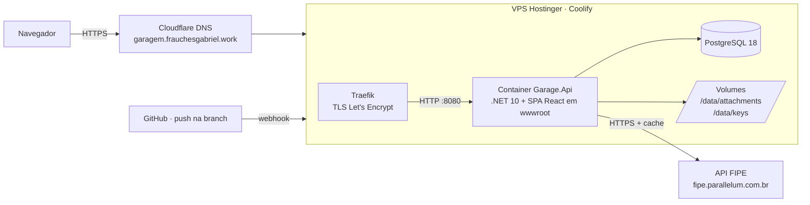
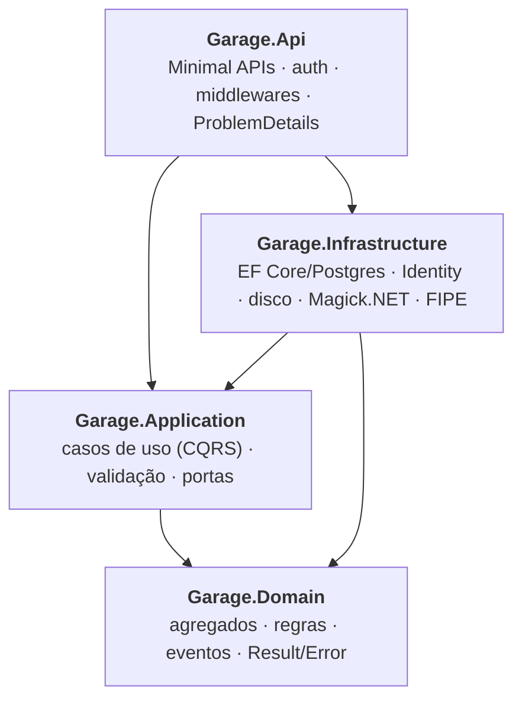
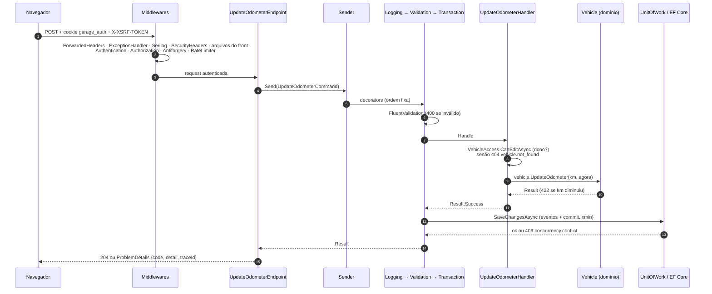
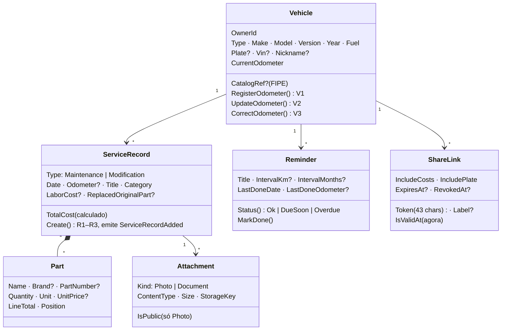
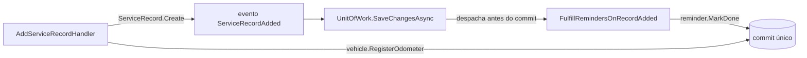

# Garagem — como o app funciona por dentro

> Visão técnica do **appMaintenceHistory** (nome no código: `Garage`), escrita a partir do código da branch `feat/fase1-backend` em 12/10/2026.
> Regras de negócio completas: `docs/superpowers/specs/2026-10-10-fase1-historico-manutencao-design.md`. Plano de execução: `docs/superpowers/plans/`.

## 1. Em uma frase

Uma API .NET 10 que guarda o histórico de manutenções e modificações de cada veículo do usuário, com peças, custos, anexos (fotos e notas fiscais), lembretes por km ou tempo e um link público somente leitura para compartilhar o histórico. O front React é servido pela própria API, no mesmo domínio, numa imagem única.

## 2. Visão de implantação

- **Deploy:** cada push na branch dispara o build no Coolify (`base_directory=/` e `dockerfile_location=/backend/Dockerfile`: o contexto de build é a raiz do repositório). A **imagem é única**, em três estágios: o Node compila o front (`npm ci` + `npm run build`), o SDK .NET publica a API e gera o bundle de migrations (`dotnet ef migrations bundle`), e a imagem final (`aspnet:10.0`, usuário não-root) leva a API, o `efbundle` e o front em `wwwroot`. O `docker-entrypoint.sh` aplica as migrations (`MIGRATE_ON_START=false` pula) e só então sobe a API; `GET /api/health` e `/api/health/ready` servem de health check.
- **Proxy:** o Traefik termina o TLS. A API confia nos cabeçalhos `X-Forwarded-*` dele (esquema para cookie `Secure`, IP real para rate limit).
- **Comando administrativo:** `docker exec … /app/docker-entrypoint.sh reset-password <email>` troca a senha sem subir o servidor.
- **Dados persistentes:** o banco fica no Postgres do Coolify (com backup agendado) e a aplicação monta dois volumes: `/data/attachments` (`Storage:RootPath`, os arquivos dos anexos) e `/data/keys` (`DataProtection:KeysPath`, as chaves do Data Protection; sem elas cada deploy derrubaria as sessões e os tokens antiforgery). Os dois diretórios existem na imagem e pertencem ao usuário não-root, então o volume novo já nasce gravável. O backup agendado cobre só o banco: a rotina para os volumes é uma pendência (spec, seção 12.4).
- **Configuração:** variáveis de ambiente da aplicação no Coolify; as chaves estão na seção 13.

## 3. Camadas (Clean Architecture)

| Projeto | Responsabilidade | Não pode depender de |
|---|---|---|
| `Garage.Domain` | Entidades e regras puras (km, registros, lembretes, anexos, links). Sem EF, sem ASP.NET. | nada |
| `Garage.Application` | Um caso de uso por pasta (`CreateVehicle/`, `AddServiceRecord/`…): comando ou consulta + handler + validador. Define as **portas** (`IVehicleRepository`, `IFileStorage`, `IVehicleCatalog`, `IAppClock`…). | Infrastructure, Api |
| `Garage.Infrastructure` | Implementa as portas: `GarageDbContext`, repositórios, `UnitOfWork`, `LocalDiskFileStorage`, `MagickImageProcessor`, `FipeVehicleCatalog`, ASP.NET Identity. | Api |
| `Garage.Api` | Endpoints HTTP finos: recebem a requisição, mandam o comando pelo `ISender`, convertem o `Result` em resposta. | — |

Essas fronteiras são **verificadas por teste** (`Garage.ArchitectureTests`, com NetArchTest): se alguém fizer o domínio referenciar o EF, o build de testes quebra.

## 4. O caminho de uma requisição

Exemplo: `POST /api/vehicles/{id}/odometer` (atualizar a km).

Peças-chave:

- **Pipeline:** `ISender` é um despachante próprio (sem MediatR). Comandos passam por `Logging → Validation → Transaction → handler`; consultas por `Logging → Validation → handler`. Registrado com Scrutor em `Application/DependencyInjection.cs`.
- **Result em vez de exceção:** handlers devolvem `Result<T>` com um `Error(code, mensagem, tipo)`. `ResultHttpExtensions.ToProblem` mapeia o tipo para HTTP: Validation 400, NotFound 404, Conflict 409, PayloadTooLarge 413, UnsupportedMedia 415, DomainRule 422, TooManyRequests 429, Unavailable 503. Toda resposta de erro é RFC 9457 com `code` estável (ex.: `vehicle.odometer_cannot_decrease`) e `traceId`.
- **Transação:** o `TransactionCommandDecorator` só grava se o handler teve sucesso. Falha ou exceção → `DiscardAsync` limpa o ChangeTracker e roda as ações de rollback (ex.: apagar o arquivo de um upload que não foi commitado).
- **Concorrência otimista:** a coluna de sistema `xmin` do Postgres é o `RowVersion`. Edições mandam o `rowVersion` lido; se outro salvou antes, volta 409.
- **Acesso:** `IVehicleAccess` responde "dono?" com uma consulta. Quem não é dono recebe **404**, nunca 403, para não revelar que o veículo existe.
- **Tempo:** `IAppClock` dá o "agora" e o "hoje" em `America/Sao_Paulo` (testes usam `FakeTimeProvider`).

## 5. Domínio

Cada agregado referencia o outro só pelo **id** (`VehicleId`), e cada um tem seu repositório. Ids são **Guid v7** (ordenáveis por tempo).

### Regras principais

| Área | Regra |
|---|---|
| **Km (V1–V3)** | Registro com km maior que a atual atualiza o veículo; atualização manual não pode diminuir; correção de digitação pode diminuir, mas nunca abaixo da maior km do histórico. |
| **Registros (R1–R6)** | Data não pode ser futura; "peça original substituída" só em Modificação; a km precisa ficar entre a do registro anterior e a do seguinte (cronologia); custo total = peças (qtd × preço) + mão de obra. |
| **Lembretes (M1–M6)** | Por km, por meses ou os dois ("o que vier primeiro"). Status = pior eixo: vencido se ≤ 0; "vence em breve" se ≤ 1.000 km ou ≤ 30 dias. Ao lançar um registro, o usuário marca quais lembretes ele cumpriu. |
| **Anexos (A1–A5)** | Até 10 MB e 20 por registro. Tipo decidido pelos **bytes iniciais** (JPEG, PNG, WebP, PDF), nunca pelo nome. Fotos são reprocessadas: converte para sRGB quando há perfil de cor, remove EXIF (GPS) e perfis, limita a 2560 px, recomprime JPEG q85. Documentos nunca ficam públicos. |
| **Links públicos (S1–S2)** | Token aleatório de 32 bytes. Revogado, expirado, malformado ou inexistente → o mesmo 404. A página pública mostra só uma lista permitida de campos. |

### Eventos de domínio

Quando um registro é criado, ele emite `ServiceRecordAdded`. O `UnitOfWork`, antes do commit, entrega o evento ao handler `FulfillRemindersOnRecordAdded`, que marca os lembretes escolhidos como cumpridos. Tudo na **mesma transação**: se um lembrete não puder ser cumprido, o registro também não é salvo.

## 6. Persistência

- **EF Core + Npgsql**, nomes em `snake_case` (EFCore.NamingConventions). Configuração por agregado em `Infrastructure/Persistence/Configurations/`.
- **Escrita** por repositórios (`IVehicleRepository`…) + `IUnitOfWork`. **Leitura** pelas consultas via `IReadDbContext` (`AsNoTracking`, projeção direta para DTO).
- **Paginação por cursor** no histórico (`RecordCursor`: base64url de data + criação + id do último item, ordem `date, created_at, id` decrescente).
- **Migrations** versionadas em `Persistence/Migrations/`; em produção rodam no início do container via bundle.
- Tabelas: `vehicles`, `service_records`, `service_record_parts`, `reminders`, `attachments`, `share_links`, `catalog_cache` (FIPE), mais as do Identity.

## 7. Segurança

| Camada | Como |
|---|---|
| Login | ASP.NET Identity, cookie `garage_auth` (HttpOnly, Secure, SameSite=Strict, 14 dias renováveis com o uso). Senha de 10+ caracteres; 5 senhas erradas bloqueiam a conta por 15 minutos. Cadastro de conta controlado por `Auth:AllowRegistration` (desligado, a rota nem existe). As chaves do Data Protection ficam em `DataProtection:KeysPath` (volume) para a sessão sobreviver ao deploy. |
| CSRF | Antiforgery: `GET /api/auth/antiforgery` grava o cookie `XSRF-TOKEN`; o front devolve no cabeçalho `X-XSRF-TOKEN` em toda escrita. |
| Autorização | Todo `/api` exige login por padrão; só health, auth e rotas públicas são anônimas. Dono verificado em cada caso de uso. |
| Rate limit | Políticas por IP (login e cadastro na mesma cota; visão pública; fotos da página pública, com cota própria; criação de demo), com IPv6 agrupado por rede /64, e por usuário (catálogo, uploads); cada conta demo tem ainda uma cota de escritas por hora (fora `/api/auth`); excesso → 429 `rate_limit.exceeded`. |
| Cabeçalhos | `SecurityHeadersMiddleware` põe `X-Content-Type-Options: nosniff`, `X-Frame-Options: DENY` e `Referrer-Policy: no-referrer` em toda resposta (inclusive erros) e, por HTTPS fora de Development, `Strict-Transport-Security: max-age=31536000`. Rotas públicas e a página `/p/` com `X-Robots-Tag: noindex`; o `index.html` do front também traz `<meta name="referrer" content="no-referrer">`. |
| Cache | Visão pública `no-store`; foto pública `private, max-age=3600` (revogar o link barra as cargas novas); anexos do dono `private, no-store`. |
| Logs | O token dos links públicos sai mascarado (`/api/public/***`, `/p/***`) em toda propriedade de todo evento do Serilog (`PublicTokenMasking`), inclusive o `RequestPath` do escopo da requisição. Cliente que abandona a requisição não vira `Error`. |
| Uploads | Detecção por assinatura, reprocessamento das imagens, nome de arquivo limpo, gravação em disco fora do webroot com chave aleatória. |
| Página pública | Projeção campo a campo (allowlist): nada de VIN, observações, documentos, lembretes ou dados do dono. Custos e placa só se o link permitir. |

## 8. Integração FIPE (camada anticorrupção)

O app não usa os modelos da FIPE diretamente. `FipeClient` busca o JSON bruto, `FipeTranslator` converte para os tipos do app (`CatalogMake`, `CatalogModel`, `CatalogYear`, `CatalogDetails`) e `FipeVehicleCatalog` cuida de:

- **Cache em banco** (`catalog_cache`): 30 dias para listas, 7 dias para detalhes e preço.
- **Resiliência:** timeout de 5 s por tentativa, até 2 retries em falhas de rede/5xx (nunca em 429).
- **Fallback:** FIPE fora do ar → serve o cache vencido; sem cache → 503 `catalog.unavailable`, e o front oferece o preenchimento manual. Uma linha de cache que não se traduz mais (contrato mudou, dado corrompido) conta como cache ausente.

Tradução: "Civic Sedan LX 1.6 16V Mec. 4p" vira modelo `Civic` + versão `Sedan LX 1.6 16V Mec. 4p`; "1998 Gasolina" vira ano 1998 + combustível Gasolina; "32000" (zero km) vira ano nulo.

## 9. Endpoints

Todos sob `/api`. A documentação interativa (`/scalar`) e o contrato (`/openapi/v1.json`) só existem fora de `Production` (o ambiente publicado hoje é `Staging`, então `/scalar` está visível).

| Grupo | Rotas |
|---|---|
| Auth | `GET auth/antiforgery` · `GET auth/config` · `POST auth/register` · `POST auth/login` · `POST auth/demo` · `POST auth/logout` · `GET auth/me` |
| Veículos | `GET/POST vehicles` · `GET/PUT/DELETE vehicles/{id}` · `POST vehicles/{id}/odometer` · `POST vehicles/{id}/odometer/correction` · `GET vehicles/{id}/fipe-price` · `PUT vehicles/{id}/cover-photo` · `GET vehicles/{id}/summary` |
| Garagem | `GET garage/summary` (gasto do ano, meses e últimos serviços de todos os veículos) |
| Registros | `GET/POST vehicles/{id}/records` · `GET/PUT/DELETE vehicles/{id}/records/{recordId}` |
| Anexos | `POST vehicles/{id}/records/{recordId}/attachments` · `GET vehicles/{id}/attachments/{attId}/content` · `PATCH`/`DELETE vehicles/{id}/attachments/{attId}` |
| Lembretes | `GET/POST vehicles/{id}/reminders` · `PUT/DELETE vehicles/{id}/reminders/{reminderId}` · `GET reminders/due` (painel) · `GET reminders` (todos, inclusive os em dia) |
| Compartilhar | `GET/POST vehicles/{id}/share-links` · `DELETE vehicles/{id}/share-links/{linkId}` |
| Público | `GET public/{token}` · `GET public/{token}/attachments/{attId}` |
| Catálogo | `GET catalog/{type}/makes` · `…/makes/{m}/models` · `…/models/{mo}/years` · `…/years/{y}` |
| Demonstração | `POST demo/seed` (só com `Demo:Enabled`; só para contas sem veículos, senão 409 `demo.already_has_data`) |
| Saúde | `GET health` (vivo) · `GET health/ready` (banco ok) |

- `POST auth/register`, `POST demo/seed` e `POST auth/demo` só são mapeados com `Auth:AllowRegistration`, `Demo:Enabled` e `Demo:Visitors:Enabled` ligados; desligados, as rotas nem existem (404).
- **Demo por visitante** (`POST auth/demo`): cria uma conta sem senha (`IsDemo`, vence em `Demo:Visitors:TtlHours`), semeia os dados de exemplo nela e abre a sessão com validade absoluta igual à da conta. A conta demo não envia anexos (403 `demo.uploads_disabled`), tem até `Demo:Visitors:MaxVehicles` veículos (422 `demo.vehicle_limit_reached`) e vence no logout (o cookie antigo passa a ser recusado em toda a API, pela validação do cookie). Os tetos valem sob concorrência: contar e criar a conta acontecem sob `pg_advisory_xact_lock`, e contar e gravar o veículo sob uma trava da conta, solta depois do commit (a API roda numa instância). O `DemoCleanupService` apaga as vencidas com tudo o que é delas (e os arquivos, depois do commit), na subida da API e a cada intervalo; se a semeadura falha, a conta sai com os arquivos já copiados. Detalhes na spec `2026-10-16-nova-interface-e-demo-design.md`.
- Fora de `/api`, `/openapi` e `/scalar`, a API devolve o `index.html` do front (seção 11); a SPA nunca responde por baixo de `/api`.
- **Contrato:** todo endpoint declara `.WithName`, `.WithTags`, `.Produces<T>()` do sucesso e `.ProducesProblem()` de cada erro. O `OpenApiContractTests` reprova o endpoint que ficar sem nome, tag ou resposta de sucesso com schema (os de arquivo declaram só o tipo de mídia; os 204 não têm corpo). O front gera os tipos desse documento.

## 10. Testes

| Projeto | O que cobre | Testes |
|---|---|---|
| `Garage.Domain.Tests` | Regras puras (km, cronologia, status de lembrete, assinatura de arquivo, Money, Plate, capa do veículo…) | 202 |
| `Garage.Api.IntegrationTests` | API de ponta a ponta com **Postgres real em container** (Testcontainers) e `WebApplicationFactory`: auth, CSRF, rate limit, cada endpoint, catálogo FIPE (com FIPE falsa), vazamentos na página pública (inclusive o token nos logs), cabeçalhos de segurança e de cache, configuração validada na partida, dados de exemplo, capa, resumos de gastos, demo por visitante (sessão, restrições, tetos sob concorrência e limpeza), hosting do front e o contrato OpenAPI | 301 |
| `Garage.Infrastructure.Tests` | Relógio em America/Sao_Paulo, armazenamento em disco, reprocessamento de fotos (sRGB), cliente e tradutor da FIPE | 85 |
| `Garage.ArchitectureTests` | Domínio não depende de nada, Application não depende das camadas externas, Infrastructure não depende da Api, handlers e decorators `internal sealed` | 4 |
| **Back-end** | `dotnet build` com 0 avisos (o build trata aviso como erro) e `dotnet test` verde | **592** |
| Front (`frontend/`) | Vitest + Testing Library (jsdom): cliente HTTP e erros, autenticação, landing e demo, menu, painel, telas, formulários, FIPE, lembretes, gastos, compartilhamento, dossiê público, recarga depois de deploy | 280 (23 arquivos) |

Rodar: `cd backend && dotnet test` (precisa do Docker ligado para os testes de integração) e `cd frontend && npm test`.

## 11. Front-end

- **Vite + React + TypeScript**, Tailwind v4, React Router, TanStack Query, React Hook Form + Zod.
- Tipos da API gerados do OpenAPI (`npm run gen:api` com openapi-typescript + openapi-fetch), então o front quebra na compilação se o contrato mudar. O script lê a API local (`http://localhost:5081`; `API_URL` troca a origem), que precisa estar com `Auth:AllowRegistration` ligado para a rota de cadastro entrar no documento.
- Telas (visual "Ficha técnica": grafite, âmbar, Archivo e IBM Plex Mono empacotadas): `/` é a landing para visitantes (com "Ver demo") e o painel para quem tem sessão (gasto do ano, lembretes, veículos com capa, gastos por mês, últimos serviços); `/login` e `/register` (só para visitantes; o cadastro só abre se `GET auth/config` diz `registrationEnabled`); `/vehicles` e `/reminders` (todos os lembretes, agrupados); `/vehicles/new` (seletor FIPE, com preenchimento manual de reserva); `/vehicles/:id` (capa, indicadores e abas Histórico, Lembretes, Gastos e Compartilhar); `/vehicles/:id/edit`; formulário e detalhe de registro (peças, anexos e "Usar como capa"); e o dossiê público `/p/:token`, fora do login e do menu.
- **Carregamento sob demanda** (`lazyPages.ts`, `React.lazy` + `Suspense`): o arquivo principal leva só a landing, o dossiê público e o 404; a moldura do app, as telas logadas, o login e o cadastro baixam quando são abertos. Depois de um deploy, a aba aberta que pede um desses arquivos (com o hash antigo) recarrega a página uma vez em vez de quebrar (`lib/chunkReload.ts`). O `index.html` pré-carrega a fonte dos títulos. No Lighthouse (celular), a landing foi de 85 para 90–92 em desempenho, com acessibilidade 100.
- **Hospedagem pela API** (`SpaHosting`): o build do Vite vai para `wwwroot` na imagem, no mesmo domínio (cookie e antiforgery sem CORS). Os arquivos estáticos saem antes da autenticação (sem login, antiforgery nem rate limit); os arquivos de `/assets/*`, com hash no nome, levam `Cache-Control: public,max-age=31536000,immutable`, e `index.html`, ícones e o fallback levam `no-cache` (o fallback sempre, mesmo em `/assets/<sem extensão>`), para o deploy novo aparecer na hora. A página pública (`/p/...`) sai com `X-Robots-Tag: noindex`. Qualquer caminho sem extensão de arquivo (`/vehicles/abc` com F5, `/p/token`) devolve o `index.html` e o React Router resolve. O fallback nunca responde por baixo de `/api`, `/openapi` e `/scalar` (continuam dando o 404 da API), nem a arquivo inexistente ou método diferente de GET. Sem `wwwroot/index.html` (testes, desenvolvimento com o servidor do Vite) ele nem é mapeado, e em nenhum caso entra no documento OpenAPI.
- Em desenvolvimento, `npm run dev` (Vite, :5173) faz proxy de `/api`, `/openapi` e `/scalar` para a API (:5081): o navegador fala com uma origem só, como em produção.
- Botão "carregar dados de exemplo" (`POST /api/demo/seed`, só com `Demo:Enabled`): Civic EK 1998 com 6 registros (incluindo a modificação de coilover), lembretes em todos os estados e um link público; Gol 2019 com 2 registros.

## 12. Estado atual

| Item | Situação |
|---|---|
| Plano 1 — back-end (T1–T15: domínio, pipeline, auth, veículos, lembretes, registros, anexos, links públicos, catálogo FIPE, contrato OpenAPI e README) e as correções da revisão final | Concluído: 525 testes verdes e build sem avisos |
| Plano 2 — front (login e cadastro, painel, veículos com FIPE, histórico e registros com peças e anexos, lembretes, compartilhamento, página pública, imagem única) | Concluído: 231 testes verdes |
| Plano 3 — nova interface e demo por visitante (capa, resumos de gastos, `GET /reminders`, demo sem cadastro com limpeza, landing, menu lateral, painel, páginas de veículos e lembretes, dossiê público) | Em produção desde 16/10/2026 (PR #1, mais as correções da revisão no PR #2): 592 testes no back-end e 280 no front |
| Produção | `garagem.frauchesgabriel.work` roda a imagem única com o front e o back-end dos dois planos |
| Pendências | Rotina de backup dos volumes `/data/attachments` e `/data/keys` (o agendado do Coolify cobre só o banco); testar uma restauração do Postgres antes de cadastrar dados reais; depois de criar a conta, manter `Auth:AllowRegistration` desligado (spec, seção 12) |

## 13. Configurações

Lidas de `appsettings*.json`, user-secrets (desenvolvimento) ou variáveis de ambiente (produção), onde `:` vira `__` (`Fipe:BaseUrl` → `Fipe__BaseUrl`). O passo a passo local está em `backend/README.md`.

| Chave | Padrão | Efeito |
|---|---|---|
| `ASPNETCORE_ENVIRONMENT` | `Production` | `/scalar` e `/openapi` só existem fora de `Production` (o ambiente publicado hoje é `Staging`, então `/scalar` está visível); HSTS só fora de `Development` |
| `ConnectionStrings:Garage` | — | Conexão com o PostgreSQL |
| `App:TimeZone` | `America/Sao_Paulo` | Fuso que define o "hoje" (`IAppClock`). Validado ao subir: fuso desconhecido, a API não sobe (a imagem precisa de ICU e tzdata) |
| `Auth:AllowRegistration` | `false` | Mapeia `POST /api/auth/register`; desligado, a rota nem existe. Ligar só para criar a conta |
| `Demo:Enabled` | `false` (`true` em Development) | Mapeia `POST /api/demo/seed` |
| `Demo:Visitors:Enabled` | `false` | Mapeia `POST /api/auth/demo` (a limpeza das contas demo vencidas roda mesmo desligada, na subida e a cada intervalo) |
| `Demo:Visitors:TtlHours` · `MaxActive` · `MaxVehicles` · `CleanupIntervalMinutes` | `24` · `100` · `5` · `60` | Validade da conta demo, teto de contas ativas (`0` fecha a demo), veículos por conta demo e intervalo da limpeza (`0` desliga) |
| `DataProtection:KeysPath` | vazio | Pasta das chaves do Data Protection; vazia, nada é persistido. Produção: `/data/keys` |
| `Storage:RootPath` | vazio | Pasta dos anexos, obrigatória: vazia, a API não sobe. Produção: `/data/attachments` |
| `Fipe:BaseUrl` | `https://fipe.parallelum.com.br/api/v2/` | URL base da FIPE |
| `Fipe:Token` | vazio | Token de assinatura (`X-Subscription-Token`): sem ele 500 consultas por dia, com o gratuito 1.000 |
| `RateLimits:LoginPerMinute` | `5` | Login e cadastro (a mesma cota), por IP |
| `RateLimits:PublicPerMinute` | `60` | Visão pública (`GET public/{token}`), por IP |
| `RateLimits:PublicPhotosPerMinute` | `600` | Fotos da página pública (`GET public/{token}/attachments/{attId}`), por IP |
| `RateLimits:CatalogPerMinute` | `30` | Catálogo, por usuário |
| `RateLimits:UploadsPerMinute` | `30` | Upload de anexos, por usuário |
| `RateLimits:DemoPerHour` | `5` | `POST /api/auth/demo`, por IP (IPv6 por rede /64) e por hora |
| `RateLimits:DemoWritesPerHour` | `300` | Escritas (POST, PUT, PATCH, DELETE) de cada conta demo, por hora; `/api/auth` fica de fora |
| `MIGRATE_ON_START` | `true` | Só no contêiner: `false` faz o entrypoint pular as migrations |
